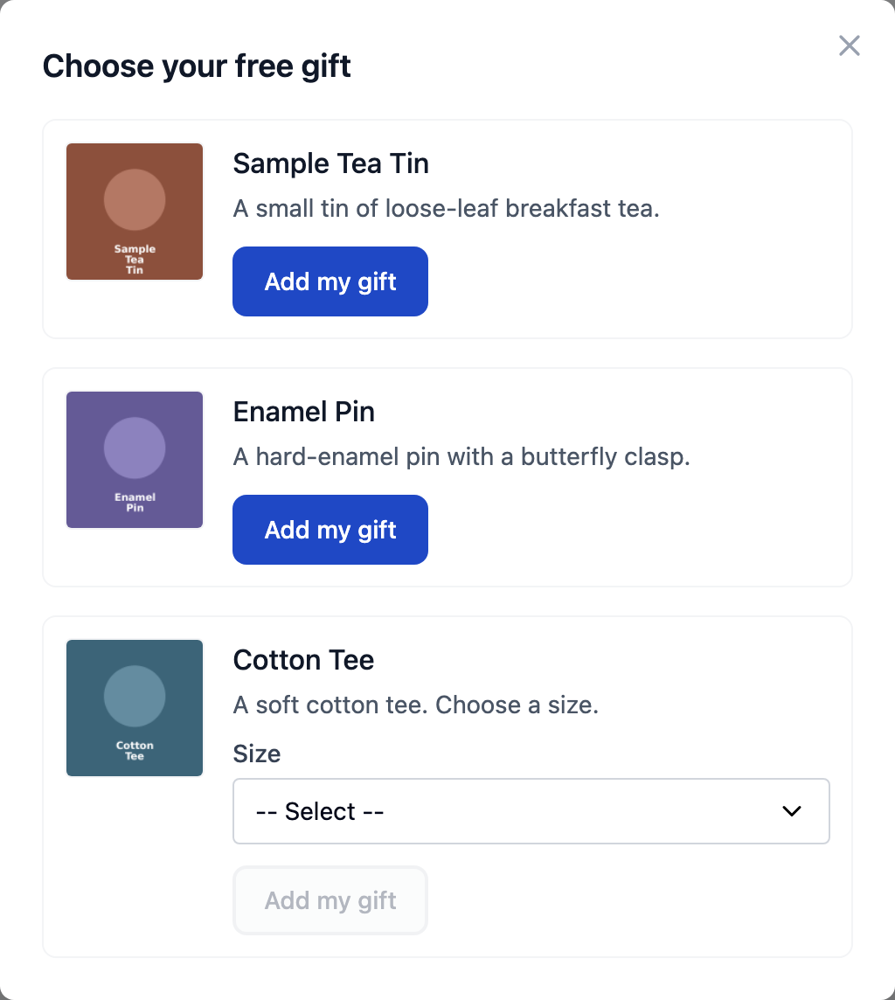
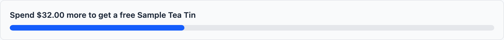
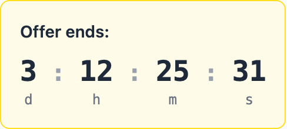

# BlueFairy_FreeGiftHyva Features

Alpine.js and Tailwind CSS components for storefronts on the Hyvä Theme (not Hyvä Checkout), bringing reactive free gift selection, progress tracking, and countdown timers to modern storefronts.

---

## Alpine.js Gift Popup

The gift selection popup appears when a "Customer Selects Gift" rule qualifies on the shopping cart. The component displays eligible gift products in a Tailwind-styled modal with support for configurable products.

**Features:**

- **Modal overlay** — semi-transparent dark background with centered white modal card.
- **Product images and details** — displays each gift's image, name and description (no price: every gift is free).
- **Configurable product support** — if a gift is configurable (e.g., apparel with size/color options), dropdown selectors appear for each required attribute. The "Add to Cart" button is disabled until all options are selected.
- **Opens only when the shopper asks** — the popup never opens by itself; it fetches its gifts the first time it is opened.
- **Add to Cart button** — customer clicks to confirm their gift selection; the gift is added to the cart via POST with a CSRF security token.
- **Trigger withdrawn at the limit** — once the cart holds the rule's Gift Quantity of gift lines the trigger button goes away, straight after the last allowed add and on later page loads.
- **Success handling** — after adding, the popup closes and the cart UI refreshes automatically.
- **Tailwind styling** — rounded corners, shadow depth, accessible focus states.

---

## Alpine.js Progress Bar

Progress bar component that shows how much more the customer needs to spend to qualify for a free gift promotion.

**Features:**

- **Animated width transition** — as the customer adds items, the progress bar width animates smoothly using CSS transitions.
- **Remaining amount message** — displays templated text (e.g., "Spend $50 more to qualify") with the calculated remaining balance.
- **Qualification state** — the fill is blue while the cart is short of the threshold and turns green, with the met message, once it qualifies.
- **Updates with the cart** — reads its state from the customer-section data Hyvä loads on every page load and after every cart change (`private-content-loaded`); no polling and no timer, and a request of its own only once, for a shopper whose stored section data predates it.
- **Tailwind styling** — custom background, progress fill, and text colors using Tailwind utilities.

---

## Alpine.js Countdown Timer

Client-side countdown timer that displays the remaining time until a free gift promotion expires.

**Features:**

- **Live countdown** — updates every second to show days, hours, minutes and seconds remaining.
- **Server-rendered end** — the promotion's end is rendered into the page by the block as a Unix timestamp: the end of the rule's Countdown End Date (else its To Date), 23:59:59 in the store's time zone. The browser counts down to that instant, so every shopper sees the same end whatever their own time zone.
- **Pure JavaScript implementation** — no external countdown libraries.
- **Automatic cleanup** — the countdown interval is cleared when the timer expires.
- **Expiration messaging** — after the promotion ends, displays "Promotion has ended" in red.
- **Flex layout** — days, hours, minutes and seconds side by side, each with its d / h / m / s label.
- **Tailwind styling** — custom colors, bold numerals for readability, and visual hierarchy.

---

## Screenshot Index

All screenshots referenced in this document, with the browser or server route needed to capture each one.

| Screenshot | Description | Route to Capture |
|------------|-------------|-----------------|
| `docs/images/hyva-gift-popup.png` | Alpine.js modal popup for customer-select gift rules, Tailwind-styled with product options and configurable attribute selectors | `https://<your-store>/checkout/cart` (triggered when customer_select rule is eligible) |
| `docs/images/hyva-progress-bar.png` | Alpine.js progress bar with smooth CSS transition animation, showing remaining amount needed to qualify | `https://<your-store>/checkout/cart` |
| `docs/images/hyva-countdown-timer.png` | Alpine.js countdown timer counting down to promotion end date, displayed as Days:Hours:Minutes:Seconds | `https://<your-store>/checkout/cart` (requires active rule with countdown enabled) |

